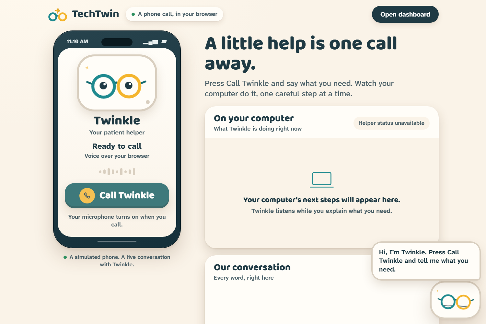
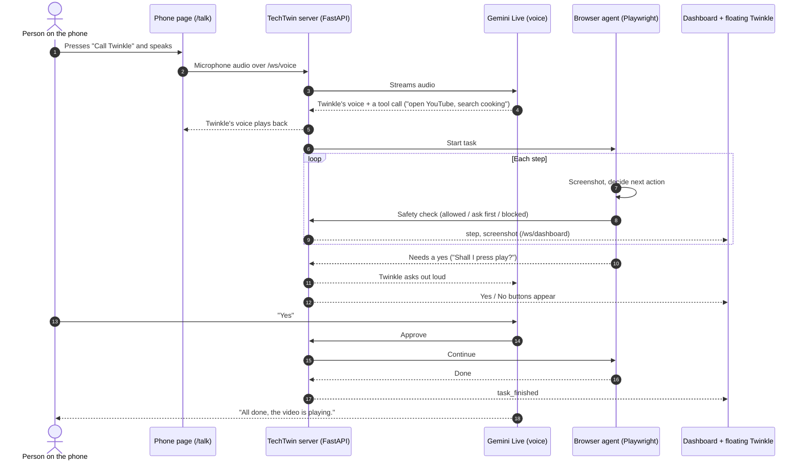
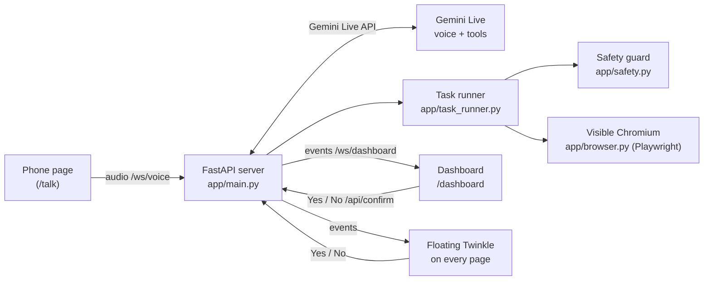
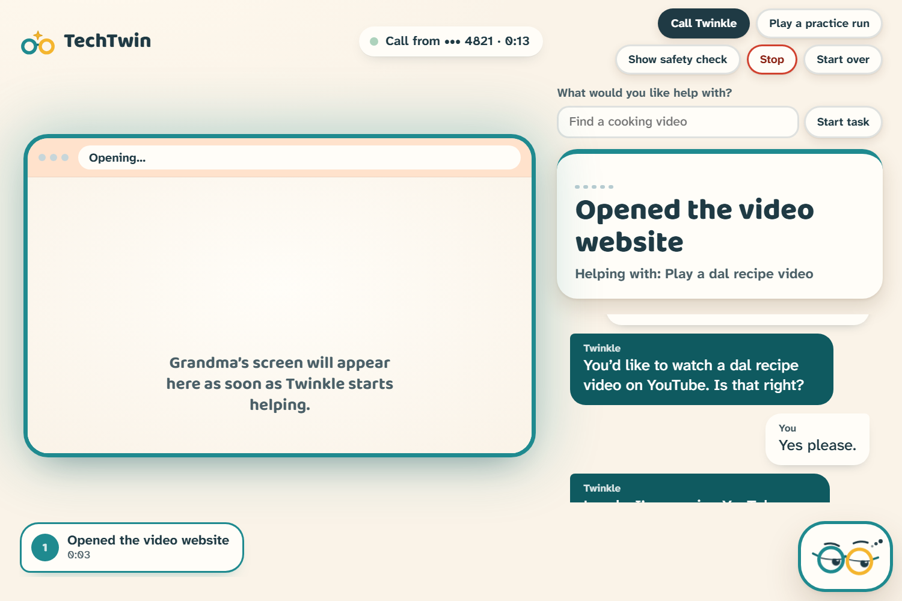

<div align="center">


# TechTwin

### Call Twinkle. Say what you need. Watch your own computer do it, safely.

A phone call for people who are not comfortable with computers. You talk to **Twinkle**, a friendly voice helper, and she does the task on your own laptop where you can see it, asking you first before anything important.

[](https://twinkle-khaki.vercel.app)




</div>

---

## Why it exists

Most of us have a parent or grandparent who phones us to ask "how do I open YouTube again?" Help apps assume you can already use a computer. A phone call doesn't: everybody knows how to make one.

With TechTwin you call Twinkle and talk to her like a person. She listens, works on your own computer in a browser you can watch, explains what she is doing in plain words, and stops to ask before she presses anything that matters. If something goes wrong, she says so plainly instead of guessing.

## How it works





**Safety is in the code, not just the prompt.** Every action passes `app/safety.py`. Payments, passwords, downloads and anything unknown are blocked. Important clicks ("play", "send", "buy") need a spoken or tapped yes first. The browser is visible the whole time, and **Stop** works at any moment.

## What you see

<div align="center">

</div>

| Part | What it does |
|---|---|
| **Phone page** `/talk` | A phone you call Twinkle on. Live voice through Gemini, the conversation as text, the laptop's screen beside it. |
| **Dashboard** `/dashboard` | The laptop's live screen, every step Twinkle took, the transcript, big Yes / No when she asks first, Stop and Start over. |
| **Floating Twinkle** | The mascot stays in the corner of every page and says in one sentence what is happening. She shows Yes / No when she is asking. |

The phone in the browser stands in for a real phone line for the demo. The server also has a Twilio Media Streams path (`app/twilio_stream.py`) for real phone numbers.

## Run it

You need Python 3.11+, a free Gemini API key (aistudio.google.com) and Chromium for Playwright.

```sh
python -m venv .venv
.venv\Scripts\activate          # macOS/Linux: source .venv/bin/activate
pip install -r requirements-dev.txt
playwright install chromium
cp .env.example .env            # put your GEMINI_API_KEY in it
uvicorn app.main:app --port 8000
```

Open **http://localhost:8000/talk** on the same laptop (the microphone needs `localhost`), press **Call Twinkle**, allow the microphone and say something like *"Open YouTube and find a video on how to make chai."* A Chromium window opens and Twinkle works in it.

No key? Open `/dashboard?demo=dal` to watch a scripted practice call. The [Vercel preview](https://twinkle-khaki.vercel.app) is the front end only, with no voice or laptop control, because those need the local server.

Tests: `python -m pytest -q`.

## Repository

```
app/            FastAPI server: voice (Gemini Live), task runner, browser agent, safety guard, events
static/         Dashboard, brand layer (fonts, logo, mascot, floating Twinkle)
voice_demo/     The phone page (/talk)
tests/          pytest suite, including a guard that the UI keeps every element id the scripts use
scripts/        Static build for the Vercel preview, demo helpers
docs/           Spec, front end guide, backend handoff, demo script
```

More detail: [docs/FRONTEND.md](docs/FRONTEND.md) (pages, brand, floating Twinkle) · [docs/BACKEND_HANDOFF.md](docs/BACKEND_HANDOFF.md) (event contract, safety rules, task runner API)

## Built with

Python, FastAPI, WebSockets, Gemini Live (native audio), Gemini (browser reasoning), Playwright, HTML, CSS, JavaScript, Vercel.

## Team

Built at **sunhacks 2026** by
- **Dhaush**: browser agent, safety guard, front end and brand
- **Maulik**: phone and voice (Gemini Live, audio, call lifecycle)
- **Shrey**: dashboard UI

## License

[MIT](LICENSE)
